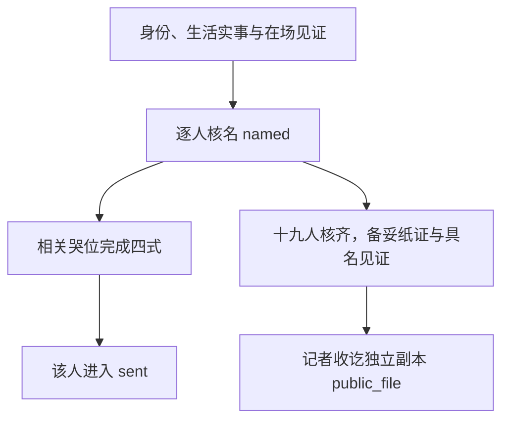

# 欠哭 游戏设计文档

**Unwept　正式 GDD 1.0　｜　剧本基线 V2.0　｜　制作组内部使用，含全部结局**

> 1998 年秋，鄂东南幕阜山区。代哭人余小满到新坳村替谷家守三夜。主人愿付足工钱，却不许她数亡父的生平。入夜，她循声去陪一个伤心的人，看到床上两个人都睡着，哭的是枕边的碗。

《欠哭》是一款单人 2D 横版手绘解谜游戏，面向喜欢慢速调查、人物叙事与环境恐怖的玩家。每一次重要发现都要让玩家指得出依据。制作从四场试玩开始，先交付能在街窗处存下来的完整流程，再扩展 1971 年回响与全村名册。

| 制作基线 | 本次交付依据 |
| --- | --- |
| 首个可玩版本 | 四场、三套底图。25—40 分钟，中心值 32 分钟。两题完整，第三题做到窗前指认。 |
| 全篇 | 六段、17 个场景号、9 套主底图、19 项独立谜题、6 个结局。常规首玩中心值 288 分钟，含试玩。 |
| 现有内容 | 全篇真相、关卡与变量已有设计。试玩四场已有可试录对白。窗后传桶至终章按关卡合同制作，逐场对白仍需分册交付。 |
| 制作假设 | 先以桌面键鼠、16∶9 横屏和离线存档建立原型。引擎、发行平台、预算及完整配音范围待定。本文的人日与性能数字用于排产和测试。 |

### 使用顺序

编剧核对“故事规则”“结局判定”和名册。关卡与程序先读“试玩四场”“水碗”“哭本”“存档”，再领取试玩工单。美术与音频按场景复用表和声画条目出件。验收从试玩走查开始，正式版再跑结局与混合状态。

[试玩四场与正式版交点](#gdd06) · [调查状态与保存单位](#gdd13) · [六个结局的判定](#gdd16) · [可领取的试玩工单](#gdd22) · [试玩验收与首次游玩记录](#gdd24) · [编号与制作依据](#gdd27)

第四阶段第一册管试玩的台词、站位、分支及出场。第三阶段管玩法节点和编号。第二阶段管人物、历史、仪式与名单。末页列出可打开的原册。两个交付格式使用同一份正文。

## 产品范围与游玩循环

**首玩体验　｜　制作优先顺序**

玩家扮演 28 岁的小满，在虚构的幸福水库、栗树坳旧村与新坳村之间调查。她会职业起腔，能唱哭别人，自己却总先把气收住。最早驱动她的是余婆留下的药债和谷家的三夜工钱。她要先把这份活干明白，才会追问谁一直没得到送别。

| 玩家这一刻要做什么 | 当场能看见什么 | 游戏怎样接下一步 |
| --- | --- | --- |
| 找位置 | 在干地横移，靠近桩、凳、门槛或街窗。热点只在可达处出现，可重查。 | 端碗比较站位，或问身边的人。路的安全看桩与脚印。 |
| 问清一件事 | 将物件、说话者、被说的人与动作并排读。只看到作业本就记“待问”。 | 回找桂芬听原话，再把证词放进唱词的空格。 |
| 试一句 | 先选证据，再主动确认发声。灯芯、碗纹或门扇给出可辨的反应。 | 猜错可单格重试。成功后留下可读的实事，变更对应人物或地点。 |
| 决定怎样承担 | 对外递交副本、村内张示、给某人送亡各有操作与见证。 | 日后回场显示已发生的事。离场时再按事实结算。 |

### 什么先做

试玩必须有横移、NPC 对话、背包用物、水碗两点比较、证言填词、街窗判断、静音等价线索及续档。正式版增加回响、文书对照、接护、具名公示和十九人送行。台词先走文字与临时声音，首轮通关后再给关键段落定录音。

玩法的主要阻力来自理解与承担。全篇以线索复查、短距离往返和明示后果组织节奏。没有战斗养成、随机掉落或麦克风输入工单。六个结局靠本周目已经发生的事分开。

## 玩家操作与界面

**桌面原型默认值　｜　键位与尺寸属于可调制作参数**

| 界面与焦点 | 键盘默认 | 指针与可见反馈 |
| --- | --- | --- |
| 横版场景 | A／D 或左右键移动。E 调查，Tab 循环当前可达热点。靠近出口再确认。 | 点地面走到最近可达处。点击热点则走到交互位并显示动作名。湿泥止步反馈见 PRO-01。 |
| 看物与背包 | I 开背包，方向键选物，Enter 使用，Esc 返回。B 切换端碗。 | 点箱、选物、点目标、确认。允许点选配对，拖拽可选。调查结束返回原热点。 |
| NPC 与播词 | E／Enter 逐行推进，方向键选当前分支。有选项时按一次只确认一层。 | 同一位置能点下一句，也能点字幕回看。隐藏分支不占焦点。可跳过已看演出，保留事实。 |
| 哭本与证据 | J 开哭本。页签为观察、证据、姓名，先选记录，再选“唱这一句”。 | 已知事实带说话人、对象、动作及出处。缺项显示可回访地点，支持从提示跳回原记录。 |
| 暂停与帮助 | Esc 先关最上层面板，再回场景，最后开暂停。所有关键动作可重绑。 | 菜单可回读、开三级提示、开关字幕和调整音量。关闭后恢复原选择与站位。 |

场景、对话、观察、唱词、暂停各占一个输入焦点。近看窗格时按“返回”只退一级。对白结束的按键须抬起后才可选下一项，避免同一点击顺带完成危险决定。

屏幕上缘留方向字幕，下缘放对白与续句提示。近看把热点名称留在目标旁，可手动收起以看清纹样。设置提供字幕字号、速度、底板明暗与减弱晃动。以 1280×720 验证持续可见字幕和两种字号。可交互轮廓同时配形状和文字。

## 故事规则与揭示顺序

**编剧与系统共同遵守的世界规则　｜　历史日期为本作设定**

| 事实 | 玩家如何得知 | 实现边界 |
| --- | --- | --- |
| 1971 年 7 月 14 日 | 20:10 旧村有人得到确认。20:30 压锣时担架路仍通。21:00 滑坡断路。21:47 扒堰。民兵返报、工程留联与长贵的口供一项项对时。 | 97 分钟分作不同决定。分洪有其水情依据，压下预警、假验收及次日报零分别追责。 |
| 当夜的哭生 | 22:10—22:30，林秀云唤十八位旁人，再唤自己，第十九段仍唱给活人。第二十段对准活着的女儿。 | 当时无人能唱实此后怎样死、如何送。灾后公开抹去死亡，又缺死后四式，十九人留下重演。 |
| 1971 年 7 月 15／16 日 | 15 日通报“零伤亡”并迫签保证书。16 日怀山等人封井立誓。1998 年井沿与残阄对应不同日期。 | 井誓暂压真实哭泣。停桶揭封、具名认错、记者收件、亡者获送各写自己的结果。 |
| 假葬与真泪 | 小满由空寿材送上船，被母亲唤过真名，能进入相关回响。余婆教她先收气，井茶会压哭。她仍能开口作证和完成四式。 | EN-05 可干眼哀悼余婆。EN-06 中水面先因送齐十九人而静，小满接完半句才落泪。 |
| 三次揭示 | F08 查实 21:47 人为开口。F09 查明小满是棺中的生还者。F11 见证林秀云最后所唱的对象。 | Demo 只让玩家听“九顺”、看到十九条布和窗碗。不给身世、末段对象或唱者署名。 |

1998 年 10 月 23 日傍晚开始，23、24、25 日为三夜，26 日出殡，27 日 06:00 工程清场。看笔记和用提示不消耗现实秒数。水位在检查通过、分段复水后的尾声才上涨。

## 六段关卡与时长

**常规首玩 240—360 分钟　｜　中心值 4 小时 48 分钟　｜　提前离场路线另计**

| 章节与节拍 | 分钟中心／区间 | 必走内容与离章条件 | 可留待回补 |
| --- | --- | --- | --- |
| 序章 开蒙　F06 | 8／6—10 | 两站测碗，听续腔和半句，读 E23，做一次饮茶决定。 | 问谷雨或长贵，查看箱衬。 |
| 一章 头夜　F06 | 48／38—58 | 灵堂唱词、街窗、公共井传桶、返后院、谷雨真哭、回灵堂，天明转 F07。 | 竹筹可由拓印补看。后院是废干井。 |
| 二章 二夜　F07—08 | 64／54—78 | 查坝房，穿泥滩，开侧门回响，核空寿材，首次接回谷雨，垭口校时。 | 漏读清点联可托桂芬，罗死后诊簿仍有留本。 |
| 三章 三夜　F09 | 72／63—84 | 发现假迁，查会签、改信与红布，穿过人群接回谷雨，救援见证核实身世。 | 核齐十九人、取全旧誓与公共署名可后补。D16 可提前送。 |
| 四章 出殡　F10—11 | 60／52—78 | 岗上辨声、板房对质、落实接护。安全者可选家庭离场或留下见证母亲末段。 | 证件去向可补记。灾夜过去固定，谷雨的当下命运取决于护送。 |
| 终章 小满　F12—13 | 36／27—52 | 查缺、停桶与取封、具名张示、逐人送亡、选择是否接半句。正式离场时结算。 | 开井、村认、收件、送人数分别保留。缺一人的证据仍能先送其他人。 |

试玩覆盖序章 8 分钟及头夜前 24 分钟。它在 288 分钟之内。正式版从窗外再走到井边，随后还有约 24 分钟的头夜内容。单章区间用于预算，慢读和支线单独计时。

## 试玩四场与正式版交点

**F06　1998 年 10 月 23 日　｜　以第四阶段第一册为对白母版**

| 场次与首玩时间 | 入场、玩家目标与输出 | 离场条件与接点 |
| --- | --- | --- |
| PRO-01 库边泥滩　0—5 分 | 新游戏。开 O05 取 O01，在鞋印、倒桩两站各测一次，选择续腔来自旧村侧。V117 练声、V118 画外“九顺”、V129 停半句。 | L03 已得，两个音已听。名字不写名册。沿右侧干路上坡。V101—138。 |
| PRO-02 新坳村口　5—8 分 | 桂芬接人。读 E23 公告部分，接井茶或倒在门外。喝下当场起音涩，倒掉保留清态。 | 公告已读且已经决定茶的去向。再进村口可读公告，茶不再递一次。V201—227。 |
| CH1-01 谷家灵堂　8—22 分 | 依 L01 给长孝布、短针布找位置，看见 5＋5＋5＋4 条旧布。建军聘三夜。读 L02，堂前只称“谷老爹”，帷内匹配握笔的证词试唱。 | PZ-01 与 PZ-02 成立、L02 可回读。灯芯合上而碗仍有纹。E10 只读寄出件。瞻仰及竹筹可选。V301—382。 |
| CH1-03 新坳街　22—32 分 | A 柴火、B 呼吸、C 床头碗。须看 C 和另一站，核两种节拍后主动指认。移开自己的碗，窗内仍在哭。 | 存“窗源”，退步或放下手。画外传来桶耳，出片名，开放回顾。V401—412。正式版在同一窗外恢复控制。 |

试玩终点将 PZ-03 的“窗源”与“传桶去向”分开。正式版中玩家跟桶，接一次或沿绳观察，在 CH1-04 取得 L04，再去 CH1-02 缝衣袋、听废井回应。试玩不生成 L04，不开放 J02，也不载入 1971 完整回响。

计时口径从库边第一次交还移动控制起，到窗源指认及第一声桶耳收束。分别记录指认与尾镜时间，暂停、设置、离席另计。

## 水碗与空间调查

**系统 A　｜　PRO-01 教学、CH1-03 判别、PZ-07 复用**

水碗回答“哭位相对在哪里”。每个调查站配置可达范围、方向文字、纹样、可见依据与已经比较的记录。显示用固定档位，可反复测同一结果。道路碰撞读取场景的干脊、桩线和脚印。

| 输入与状态 | 制作动作 | 可观察的判断结果 |
| --- | --- | --- |
| 接近与端碗 | 点“放稳”或切换持握，进入本站近看。未站稳只显示可移动位置，不消耗水或道具。 | 鞋印纹疏、倒桩纹密，布条往坡上吹，纹聚向旧村。已测两处才开放方向选择。 |
| 窗 A 与 B | A 合上灶门或放稳比较。柴火两短声，右侧哭腔拖长。B 降灯避反光，对照嘴闭、被角两起与哭腔一长。 | 每站比较后可回放方位文字和动作。只走过站位不会自动完成观察。 |
| 窗 C 与指认 | 再看同一窗格显出床头水纹。可把自己的碗挪远或回看被角。判题需要 C 与 A／B 至少一个，并已比较呼吸与窗后水纹。 | C 先到也可在原地再看窗格、补看窗左。选“床头那只碗”才完成窗源。误指柴或人，将对应节拍并列后回原菜单。 |
| 旧村泥滩 | 水纹最强处恰有塌草垫。玩家先连承重桩和脚印，再沿干脊接近侧门。 | E05 支持辨路。踩到浮泥退回上根桩，已测位置保留。可重走任何已证实的干路。 |

给美术两种分明的纹样。空间越近，起纹越密，方向箭头与文字同步。配词出错时，两道短急纹固定在同一处，同时显示错在谁或哪项事实。静音、单声道和黑白画面均能分辨。

## 现世与一九七一年回响

**系统 B　｜　首次完整切换发生在二夜 CH2-05**

把两个年代画在同一机位上。每个可切换的哭位存现世锚点、过去锚点、可唤对象、启用节拍、观察片段与退出点。只在相关哭位出现“起式”。玩家随时可退回原来的干地，离开时记下实际看到的片段。

| 节点与前置 | 玩家动作 | 写入与保护 |
| --- | --- | --- |
| PZ-08 祠堂侧门 | 穿过 PZ-07，用缺角与钉距拼残框，见 L05 与 E15 签名，唤陈守义。 | 现世墙痕和回响里的手对位。只展开 E24 的侧门片段。缺交接联可回板房或请桂芬取。 |
| PZ-09 厝屋 | 对齐三处棺枕。回响看签背，现世看门边擦痕，拿 E15 校准“封、封、空”。 | 记 L06 与 E24 对应片段，确认门侧空材被推出。还不能认出里面是小满。 |
| PZ-18 门槛末段 | F11 已核 birth_known、继续留下，在 CH2-05 用“林秀云”起式。看护膝、倒签、船灯的方向可换。 | 22:05 安顿作引，观察 22:10—22:30。辨认十八人、她自己、孩子。错误把孩子列为死者时回示红布与接船见证。 |
| 复访与退出 | 中途离开回响保留已见角度。返回同一门槛重看，观察不足可补。 | seen_echo 按片段去重。已送者不再单独重演。显示年代、环境轮廓与方向字幕。过去的人与物不能被移动来改写灾难。 |

转场只换与年代有关的主层和音轨，门槛高度、角色脚点和行走方向对齐。回响里的钟面停在 21:47，只标开口。日志与返报决定事件顺序。记者不能凭回响刊名。

## 哭本与十九人的送别

**系统 C　｜　同一界面承担试玩的一句与终场的四式**

每行将身份、生活实事、当夜遭遇和告别去向连到出处。观察后可记“待问”，核准后才可引用。玩家选证据、确认发声，允许逐行暂停。无需按节拍输入。起、数、劝、送都唱实，才把一个 D 号写入 sent。

| 阶段 | 绑定事实与正确反馈 | 出错或缺证时 |
| --- | --- | --- |
| 起 | D02 借 E03 的“宋氏，媳代”和 E14 的本名唤“叶冬梅”。对应哭位应声。 | 错人灯芯暗。回看姓名证据与在场辨认。 |
| 数 | 68 岁，秀兰记得膝下的小枕和勒得紧的结。词指向她身上发生的事。 | 错生平或年岁出现固定急纹，标明可回查字段，只重试本格。 |
| 劝 | 她等担架，原本想上山。警锣受压在前，后山路断在后。 | 若唱成“她不肯搬”，并列担架记录与返报，再选事实。玩家不能代替死者原谅谁。 |
| 送 | E15 有搬到北坡的凳子。唱到给她留的位置，整行才记“已送”。 | 去向错，门扇半合。缺证显示保管人。回访时已送行只读名。 |

Demo 在堂前依约起、收称谓。帷后只试“数”的一行。L02 指明是谁扶谷雨写字。错误的船灯属于长贵，井茶属于桂芬。灯稳说明唱词对上，小满的碗仍有纹。这里不会产生任何人的 sent。

终场按 D02—D19 后 D01 翻页，每人显示自己的名字与生活细节。最多三处手动接词，对应 D02、D19、D01。其余完整行由玩家选本页要送的人，用已有证据接唱，可逐人暂停。D16 已在三夜厝屋获送就只读名。其他行缺证仍可继续。全送以后水面先静，最后的女儿回应另记。

## 谜题实施表 前半程

**保留原编号　｜　每道题复用观察、选择、证据或回响面板**

| 主号与处置 | 门槛与玩家怎样解 | 结果、错误与再入 |
| --- | --- | --- |
| PZ-01 孝布辨亲　保留 | F06、CH1-01。桂芬交布并示范。长布给建军高钩，有短针的给谷雨矮凳，顺序自由。 | 两处正确露十九条旧布，开放 PZ-02。错布退回一条，正确摆位保留。 |
| PZ-02 起式初唱　修改 | PZ-01 后。堂前称谓，帷内把 L02 放入“数”，主动确认。 | 写两步，通街窗。未问桂芬可叫到帷边补录。选错仅有急纹。 |
| PZ-03 夜哭溯源　保留 | PZ-02 后。C 与另一站对照、主动指认。窗外沿桶声接桶或沿绳观察。 | 窗源是试玩边界，传桶另写一步、得 L04。误指复播节拍。原 PZ-04 合并到传桶。 |
| PZ-05 闸房日志　保留 | F07 初读 E04／05 即可拿地图。F08 在垭口取留联，与 E07、长贵所见对应 20:10、21:00、21:47。 | 第三格核完才坐实人为开口。答错比页角时刻。初读不挡 PZ-07。 |
| PZ-06 方案图压痕　保留 | F09、PZ-05 已核开口。斜光读草案，依 E04／06 比擦痕、签字与确报。 | 证实周知情仍签。若当成已发停工令，回看收件栏。可用留联与当班人补。 |
| PZ-07 涟漪地图　修改 | F07 已见 E05，学过测碗。沿承重桩过干脊，碗探侧门。 | 打通旧村路线。踩浮泥退上一桩，已证实干路可快捷重访。 |
| PZ-08 神主牌补全　修改 | PZ-07 后。E15 签名与 L05 相合，在侧门起陈守义。 | 开首段回响。拼到中门就显错钉距，缺 E15 可取摘录。 |
| PZ-09 回响数棺　修改 | PZ-08 后，持 E15，三处棺枕叠看，找出门侧空材和 L06。 | 只证明空材移动。数残木答错则重看签背、擦痕与清点联。 |
| PZ-10 手印簿对照搬迁册　保留 | F09 从 E01、E02 查旧粮柜卷号，在新坡并 E03 与 E11 对日期、分户。 | 先证假迁，再逐户核名。错把代领当本人搬走则比钥匙栏。原 PZ-12 合并到照片步骤。 |
| PZ-11 谷雨追踪　修改 | F08 循鞋印寻人，约定 L07 双道粉线。F09 穿人群，F11 决定接护。 | 前两段均可接回。人群碰撞退巷口。只有实际塌陷才失踪。原 PZ-22 合并到人群步骤。 |

## 谜题实施表 后半程

**全篇 19 项独立谜题　｜　7 项保留、12 项修改，另有 3 个旧号合并**

| 主号与处置 | 门槛与玩家怎样解 | 结果、错误与再入 |
| --- | --- | --- |
| PZ-13 童谣解码　修改 | F09，E22 加 E12 核同户兄妹，把“辣”校成何腊生的“腊”。可先查学籍。 | 墙字擦了可读校存页或重听文本。仅凭读音不入名册。 |
| PZ-14 襁褓布　保留 | F09，在接生屋拼 O04 与 O05 衬里，对撕口、断针及回纹。 | E19 只认布。E13 和救援证词才认人，家事夹层可略过。 |
| PZ-15 誓井灰　修改 | F09，L04 或重看井沿，加 E09。分开 15 日保证书与 16 日残阄。 | 查明誓物和原址，不开井。错序回看日期，可到井口补见证。 |
| PZ-16 棺盖暗槽　修改 | F09，E10 寄件、底稿、盖外槽。桂芬协助或循榫向取遗嘱。 | 核出 letter_known。误拉棺钉则提示外沿。出殡后桂芬保管可补。 |
| PZ-17 送葬路　修改 | F10，岗上两站比同句远声，看真人招手与高路标记。 | 得 L08 的岗上所闻。误跟远声可由队尾接回，门内部分 F11 再补。 |
| PZ-18 母亲的二十分钟　修改 | F11 已辨母女、决定留下，唤真实姓名，换位见末段 E24。 | 得二十段的对象，孩子仍生还。看漏角度可重入。无需先开井。 |
| PZ-19 对质证据　保留 | F10 有一组独立、有来源的材料即可会面，分别摆水情、假验、禁锣与报零。 | 独立写回应、托付、收讫与兑款。只递怀表须补签字。F11 前后可回交。 |
| PZ-20 十九名哭词　修改 | F12 祠堂。按人查核名、生活、遭遇与去向，玩家选本页送谁。 | 每人整式写一次。缺证仅标该行。D16 的 F09 个人送别承继。 |
| PZ-21 誓井开启　修改 | F12，补 E09，停桶，有知情人在原井口取封并解除约束。 | 写 well_opened。只倒空桶会看到桶链仍在，回找证人。村内张示另算。 |

原 PZ-04、PZ-12、PZ-22 保留为别名，只指向对应主号下的步骤。无独立删除或新增的谜题号。PZ-19 比 PZ-18 先发生。PZ-20 与 PZ-21 可各自进行，二者均不以对方已完成作为入口。

## 文书 核名与公开证词

**每项推理要能回答“谁写的、何时形成、能证实什么”**

| truths 中的一项 | 核实所需 | 容易出错的替代判断 |
| --- | --- | --- |
| 迁完造假 | E01 验收单，加 E02 交钥记录或 E03 独立粮册。PZ-10 可先确立矛盾，再回访分户。 | 一张照片可证拍摄日有人，不能单独证灾夜在祠堂。 |
| 知情与分洪 | E04 收报、E05 水尺地形、E06 技术会签核顺序。 | PZ-05 初读和怀表时刻各只能支撑一部分。 |
| 禁锣早于路断 | E04、E07，加长贵所见或 E17。20:30 与 21:00 是不同证物中的时刻。 | 同一返报的两份抄件仍同源。需区别何人见裹锣、何人走到滑坡。 |
| 灾后报零 | E08 通报与有名有姓的现场见证互核。 | 县存与村存可互校字面，两份“零”不能替死者证明其死亡。 |

哭本按 D 号分别存身份、生活来源、当夜在场。秀兰逐行辨认或 E24 的可辨动作可供小满核名。外递材料另须现实文书、覆盖所述主张的具名亲历证词、独立副本与记者田映秋的收件凭据。

工程卷的原页留档。玩家将原件托付某人、抄存副本、交记者这三步有不同收据。公开发布与村口更正分别结算。暂交建军仍可补抄。记者收讫后，退回原件不会撤掉外部副本。

| 资料类型 | 必填字段与例子 |
| --- | --- |
| 文书或证言 | E／L 号、子件、形成日期、保管人、独立来源、能支持的主张、可交状态、替代取得处。E10 在试玩只点亮“寄出件”。 |
| 名册行 | D 号、本名与称谓、生活实事来源、在场见证、死因、去向、对应哭位、已核／已送。界面显示具体缺哪格和现已开放的补查地点。 |

## 调查状态与保存单位

**主档由本周目持有　｜　集合用稳定 ID 去重，数量由集合派生**

| 状态与类型 | 新开默认 | 写入点、读取与回补 |
| --- | --- | --- |
| beat、scene　枚举 | F06、PRO-01 | 演出落定或玩家过门写入。F06—F13 各有自己的阶段，同场复访沿用 scene。 |
| puzzle_steps　逐题步骤集合 | 空 | 成功才加入目标步骤。领取、暂放、窗源、传桶、三次寻人分别存。相同事件再入只复现结果。 |
| notes　观察集合 | 空 | L01—L08 或有据的局部观察。两站先各存一侧，完成对比才给整条 L03。不按收集总数解锁结局。 |
| evidence、parts　集合 | 空 | 文书与子件分别记录。如 E10 的寄出件、底稿、遗嘱，E24 的可见片段。补抄或转交保留笔记。 |
| truths　四项集合 | 空 | 只在文书与独立见证满足对应推理后写。真线需四项，回查入口见前页。 |
| drank_oath_water、oath_effect　布尔／枚举 | 否／清 | 喝茶改“是／压哭”。不续饮到次日天明或开井解压，饮用史继续保留。门槛另记“是否已经做过茶决定”。 |
| saw_tally、tally_read　布尔 | 均否 | 看清 O03 或拓印才写前者。对 E10 与浅刻新旧才写后者。三夜可补，不强制摸过竹筹。 |
| letter_known、birth_known　布尔 | 均否 | E10 对出改信才写前者。E13、E19 加秀兰或长贵见证救援才写后者。家庭磁带独立。 |
| named、seen_echo、sent　集合 | 均空 | 按人核名、按片段见回响、按人完成四式。sent 必为 named 的子集，D01—D19 各最多一行。 |

另存站位锚点、所在年代、背包持有和摆位、已发道具与已触发的一次性演出。可复用的局部检查结果存在本题步骤里，避免添加第二个代表同一事实的全局布尔值。

## 人物选择与不可撤回的后果

**角色关系、公共行动与家庭离场　｜　存档字段沿用第三阶段**

| 状态与类型 | 默认与可能值 | 写入、补救与锁定点 |
| --- | --- | --- |
| trust_lan、trust_jian、trust_zhou　三级 | “保留”，另有“避谈／肯说” | 陪护、归还私物、让本人核签影响谁主动开口。可解释、改托他人或查留联。低信任仍能走真线。 |
| escort、yu_state　布尔／枚举 | 否／在村。另有暂时跟丢、平安、失踪 | F08／09 找回孩子。F11 落实成人接应或亲自陪高路才记平安。接护未定仍在事件中，不能提前结算普通结局。 |
| risk_steps　选择集合 | 空 | 分存调走原接护人、选低埂、已提示危险仍前进。改道或叫援撤销未发生的危险链。三项齐、无人接应且真塌陷才失踪。 |
| original_holder、kept_copy　逐件枚举／布尔 | 保管人／否 | 托付、抄存、寄存各按件写。县档原件留卷。临时交件不等于交易，已交外部独立副本不可撤。 |
| public_file　布尔 | 否 | 未履约，十九人核名、可查档案、具名见证，田映秋收讫独立副本才为真。当天见收件条，事后见报。 |
| deal_state　枚举 | 无。已邀、拒绝、暂应、已履约 | 仅未收件、未村内张示时可撤署名、交还可用副本并兑清药款。暂应可反悔。履约后封存本次证词，关闭新递件、集体张示和解誓。 |
| village_ack、well_opened　布尔 | 均否 | 当众认责＋具名更正张示留村才记前者。停桶＋知情者原址取封才记后者。两者独立，清场前可补。 |
| family_known、home_exit　布尔 | 均否 | E20、E21 再核怀山笔迹或捎信证词。安全、未履约、未收件、仍有未送者，主动收箱离场才写后者。 |
| sang_20th　布尔 | 否 | 身世与 E24 末段已明，孩子平安、村认且井开、十九人已送。小满主动以女儿身份接“沉”。试哼不会置位。 |

## 续档与事件提交

**开发验收用的样例　｜　“窗源”是强制断点，“传桶去向”仍在正式版**

| 存档样例 | 窗前正常通关存什么 | 新版本载入后做什么 |
| --- | --- | --- |
| 版本与位置 | 存档结构版本、beat＝F06、scene＝CH1-03、现世、窗外站位、朝街尽头。 | 核对结构版本和场景 ID。恢复人物、朝向、可走区域与下一步提示。 |
| 场景进度 | PZ-01 已成。PZ-02 含堂前称谓和有据私唱。PZ-03 有 C 与另一站、呼吸对照、水纹、窗源，未记传桶。 | 不重发孝布，不强播窗镜，显示“循桶声向右走”。已查 A／B 按实际路线重现。 |
| 证词与分支 | O01／05 持有。L01／02／03 可读。E23 公告、E10 寄出件可读。L04 未得。饮茶史、压哭状态、见筹各按本次。 | 空茶杯不重复递，仍可回读三条记录。竹筹可补。喝／倒两种档都能接上。 |
| 世界状态 | named、sent、seen_echo 为空。letter_known、birth_known、well_opened、sang_20th 为否。 | 不能从“试玩已结束”推导 1971 片段、身份、开井或整项 PZ-03 完成。 |

完成事件时一次写入事实、背包、下一步、一次性演出标记与站位，先写临时档、校验后替换当前档，保留最近一份完整副本。中途退游戏只回到最近已提交的观察或句子。复听与浏览不发道具、不改变已送状态。

在 F10／11 出殡重大选择前留独立分支存档。线路结束只将结局号写入回顾。读取分支档恢复当时所有人物、材料、sent 与选择。另一路取得的名字和结局不得倒灌。

迁移按稳定 ID 与已知子步骤。若未来旧档只有 PZ-04、12、22 的事件记录，只映射到对应子步。缺少窗源、核名等证据的部分保留可补入口。遇到新版本不认识的存档，原档保留并提示版本，不默开新游戏。

## 六个结局的判定

**本页顺序同时决定优先级　｜　只在明确离场或真正失踪后结算**

| 顺序与结局 | 必要条件 | 尾声读哪些事实 |
| --- | --- | --- |
| 1　EN-02 替哭 | F11 三次危险选择齐、没有接应，低埂实际塌陷，yu_state＝失踪。此前已收件也优先走本项。 | 家人找人，长贵开船，小满为孩子唱。若记者已收件保留刊名后续。 |
| 2　EN-04 封口 | 谷雨平安，deal_state＝已履约。撤署名、交回可用副本、实际付清药账。 | 小满还债，建军保工程，谷雨日后接井水。已送的行不重欠。 |
| 3　EN-05 二十七张汇单 | 谷雨平安，family_known 与 home_exit 为真，未履约、未收件，sent 少于十九。 | 小满从另封的钱里还第一笔药账，写自己的姓名，干着眼睛哀悼余婆。 |
| 4　EN-06 小满 | 四项 truths 齐，改信、身世、E24 末段已明，named 与 sent 各十九。谷雨平安、未履约，村认、井开且本人接完第二十段。 | 碗先静。“沉”与“娘，我上岸了”由女儿说。谷雨当着父亲哭。县报可已收件或未收件。 |
| 5　EN-03 有名无哭 | 谷雨平安，public_file 为真，sent 少于十九。 | 核实后县报刊出十九名，尚未送者的哭位仍起纹。保留已送者的告别。 |
| 6　EN-01 哭满三夜 | 谷雨平安，主动收束受雇丧礼或清场离开，以上五项均未成立。 | 正常结工钱。若已送全则碗静，仍可留封井或未接半句。有收件则刊名后续照常。 |

悲剧在塌陷搜寻后收束，隐藏线在主动收箱时收束，其他结局在自愿离场或清场节点判定。只听完磁带仍可继续。暂应贺且未收款仍能反悔。未落实接护时继续 F11，不能直接落入最后一行。

玩家可以在哭本看到“待核事实、未送者、井封、张示、接护”等具体缺项，并获知下一个去处。真线指引不要求家庭夹层、听出音高、首次追人赶上或取得特定 NPC 的最高信任。

## 场景与底图复用

**17 个场景号　｜　9 套主底图　｜　首次试玩只启用 BG01—03**

| 主底图 | 稳定场景号 | 实际交件差异 |
| --- | --- | --- |
| BG01 库边北岸 | PRO-01 库边泥滩 | 近芦、干地、倒桩、远处旧村分层。二夜加桩线和侧湾水层。方向与开场一致。 |
| BG02 新村横街 | PRO-02 新坳村口、CH1-03 新坳街、CH1-04 新坳老井 | 日公告、灶门、双窗、夜桶链、公共井独立图层。后续可在同街段换住户。试玩到窗为止。 |
| BG03 谷家剖面 | CH1-01 谷家灵堂、CH1-02 谷家后院 | 单独帷角、灯芯、长短布、高钩与短凳。后院缺砖的废井没有桶链。 |
| BG04 坝房与板房 | CH2-01 坝上闸房、CH2-02 工程组板房 | 前者日志柜／水尺，后者折图／记者桌。相邻可通行，保管人及招牌不同。 |
| BG05 新坡木房 | CH2-03 新坳村小、CH2-04 秀兰接生屋、CH2-08 新坳卫生所 | 共用梁柱。墙字、帘布、药柜三组陈设定位各房。罗死后药柜可查。 |
| BG06 旧村祠堂 | CH2-05 旧村祠堂 | 现世残墙与 1971 完整屋顶用同一门槛高度。终章按 sent 删相应人影。 |
| BG07 旧粮房与厝屋 | CH2-06 旧村厝屋、CH3-01 旧村粮站 | 厝屋作第二套完整回响。粮站只留卷号，完好底册在新坡。两地各有入口与摆设。 |
| BG08 垭口 | CH2-07 垭口钟楼 | 警锣、旧泄口同画。回响叠手、布和锣箍，控制整套年代重画的成本。 |
| BG09 岗上山路 | CH4-01 送葬路、CH4-02 听石岗 | 前景石块、真人手势、低埂断口和高路双线各可辨。岗上与门内不共用完整字幕。 |

美术交分层底图并标行走线、遮挡区、相机边界、NPC 脚点和可达热点。关卡按场景号加载底图的区段与昼夜。索引保留缺号，复访不另编场景号。

## 美术 动画与声音交付

**首批资产按“哪一次玩家判断会用它”验收**

| 交件包 | 首批内容与复用 | 验收动作 |
| --- | --- | --- |
| 主角与家人 | 小满侧走、停步、端碗、起腔、按喉。谷雨蹲听、桂芬递茶递布、长贵刮泥、建军握钥匙。可选秀兰只见袖与手。 | 灯、瓷碗与嘴的动作可独立播放。字幕开启后仍能看见短针、被角、窗内两只嘴。 |
| 物件与遮挡 | O01 豁口碗、O05 箱、长短布、柜门、坏凳、粉笔和作业本。窗里人与床头碗、帘与窗框各成层。 | 露出哪一侧亮边由站位控制。可调查区比画出来的短针大，支持焦点导航。 |
| S01—04 | 泥／箱、两站疏密纹、练声与身后续腔、喝茶／倒茶。对 S03 单独录 V117、118、126—129。 | 停声后再出“九顺”，字幕只署方位。风向与纹向不同。门槛两路有不同吞咽或倒水动作。 |
| S05—06 | 灵堂器物和闷锣分轨。正确与两种误唱分开。V361—362 公开称谓，V368／370 误唱，V373—374 正确私唱。 | 灯稳与纹仍在可同屏验证。切换场景、复听证词不会叠播另一条对白。 |
| S07—09 | 柴爆、两人呼吸、长哭、自己的碗、远处桶耳分轨。首次桶耳出在成功指认后。 | 静音时仍见柴星、被角、水纹、屏边桶耳轮廓与方向字幕。不得在指认前标“碗在哭”。 |
| 正式版增量 | 两套完整年代场景、三组人群遮挡循环、一套四式基础腔、十九个名字、六位深查人物短句，十三人各有完整文本。 | 每个名字可暂停、回读。减少环境动画时保留帮助判断的动作与字幕。 |

试玩对白母版共 159 条（含互斥分支），四场分别为 38、27、82、12 条。V 号绑定原词、说话人、触发条件和字幕。另有 S01—S09 的声画提示。从原册导出台词，临时对白与最终录音共用 V 号。

画面以生活中的动作维持调查节奏。有人撕纸、摆筷、回灶上看粥。异常跟在这些动作之后。镜头留在玩家一侧，被遮住的地方可回看。关键答案不得只靠颜色、左右声道或一瞬的动作。

## 人物与证人调度

**NPC 的出场、可知范围与补证入口**

| 人物 | 让他有自己的事做 | 他能交付什么，缺席时怎么办 |
| --- | --- | --- |
| C01 余小满、C02 谷雨 | 小满还药债，谷雨护作业本。借用字迹要先还纸。后院缝口袋、两人在高路约双线。 | 谷雨会独自真哭。擅抄墙字影响关系。可补还纸，学籍和窗灯仍能指路。 |
| C03 谷秀兰 | 推棺救出孩子，却对家里隐瞒了多年。关灯前总洗两遍手。 | 可指认当夜的在场人并揭封。低信任仍可辨名单。长贵能补救援与揭封见证。 |
| C04 谷建军、C12 邹桂芬 | 建军办父亲丧礼、怕旧事伤女儿，隔衣握钥匙。妻子桂芬把筷子又摆到公公的座位。 | 改信由建军承担。桂芬保底稿、可代取清点联和诊簿，能接护谷雨。只知她亲见或保管的事。 |
| C05 杜长贵、C06 周启明 | 长贵刮船边的泥，避看旧村。周给人热饭，先给一张真能指路的图。 | 长贵承认裹锣又接船。周可核签或给怀表。周避谈可查工程留联。怀表不能单独证明命令。 |
| C07 林秀云、C08 余桂英、C09 谷怀山 | 一人把碗缺口转向自己，一人教徒弟收气，一人给孙女留下最后一个点。三人当下均已去世。 | 母亲靠现场与纸证辨认，余婆有晚年磁带，怀山有真遗嘱与寄款。C07 与 D01 同一人。 |
| C10 贺振国 | 以保下坝为由签令，也压警报，面对档案才出价替小满还药账。 | 交足材料才实付。田映秋已收件或村口已张示则不兑款。别替他在终场突然认下所有责任。 |
| C11 罗春生、C13 梁素琴、C21—24 | 罗于二夜死亡，梁老师管学籍。彭万根管粮册。汪顺喜、曹立冬走过担架路。田映秋收材料。 | 每位只证亲历或保存事项。罗死后开留本，教师可核笔迹，两民兵可互替返报。 |

亲属表以怀山→建军→谷雨为一支，怀山之弟怀水、妻秀兰、子水生为另一支。谷雨称秀兰“婶奶奶”。水生死于 1973 年，不在十九人中。小满的生母是林秀云，抚养人与师父是余婆。

## 各章恐怖演出的触发与回访

**横版镜头留在玩家一侧　｜　同一底图的第二次经过可以看见新的证据**

| 章节 | 谁触发，画面如何变化 | 组织声音、理解与重访 |
| --- | --- | --- |
| 开蒙 | 玩家停唱向前走，倒桩刚出屏，旧村一侧才接“九顺”。杜叔仍刮鞋，风吹布条与碗纹方向不同。 | 方向字幕随声音从身后出现。可自己回头复听。后来 E03／14 和粮站证人把两个音还给熊九顺。 |
| 头夜 | 指认床头碗后追桶，门板遮住桶，下一家已伸手。接一次或循绳才能看见水正往公共井里添。 | 初探是日常劳作的磨痕。三夜核为续誓。返场看绳与石楔，睡觉与传桶的是两批人。 |
| 二夜 | PZ-08 唤对守更人，同位门框另一侧显出扶木的手。退出现世只留原位磨痕。厝屋空位须换年代对照。 | 方位字幕、掌影与磨痕给同一证据。重入回到干地锚点，允许重看。桌边饭盒和热饭保留正常声。 |
| 三夜 | 看过井沿再回巷，前景晾布掠过，一排脸上有泥的人朝低处走，手里还攥收衣夹。谷雨的雨壶仍清。 | 地面双线与灯指向上巷。碰到人只退巷口。先前看似哭泣的泥痕，由登记和枯井私哭重新解释。 |
| 出殡 | 岗上收到的是断字，走进祠堂门槛才听清。看护膝、倒签或船灯，柱后船灯出了画，手仍扶住卧床者。 | 岗上字幕缺字，门内显示姓名。玩家能重选观察位。长贵既扣过船，也实在去接过人，两次动作都有证言。 |
| 终章 | 玩家每送实一行，水中相应人影退出，空凳仍留给本人。最后一人退去，全碗先静。 | 逐名字幕支持逐行停顿。女儿落泪激起的一圈纹自己散开。退回来读已送行，只见原位空着。 |

每章保留一个照常进行的家务动作，让异常出现在玩家能够回头查看的地方。没有调查必要的窗、药柜或箱扣只回以日常声音。首次演出的触发与主动复看分别记，角色走出屏幕时保持输入与方位一致。

## 系统模块与内容接口

**程序与关卡交接　｜　以下为制作接口约定，独立于具体引擎**

| 模块 | 输入与职责 | 对其他模块提供什么 |
| --- | --- | --- |
| 场景与交互 | scene、beat、年代、站位、热点启用条件、可达线、目标物件。场景读取配置并接受一个动作。 | 返回可观察依据和动作名。只负责呈现，不在动画末帧直接判结局。 |
| 证据与哭本 | E／L 子件、来源、说话人、对象、字段、独立来源组、D 号、证词能否公开。 | 查询“可看／待问／可引用／已核／已送”。返回真实缺项和回访目标。 |
| 谜题与演出 | PZ 号、步骤、前置、允许输入、反馈与提示、成功时新增状态、V／S 引用。 | 同一事件统一提交一次。对白、特效、字幕只读取结果。重播通过单独入口。 |
| 世界与存档 | 可变的本周目状态、持物人与副本、事件提交记录、档案版本与稳定站位。 | 校验 sent 是 named 的子集。收讫独立副本和已送事实在同周目里不可倒退。 |
| 结局与回顾 | 只读角色命运、四项事实、记者、交易、村认、开井与家庭离场。读取正式离场信号。 | 输出一个 EN 号与已发生的尾声片段。回顾看过哪些结局，不反向改主档。 |

PZ-02 的内容行可以直接拿来联调。输入为“选择 L02，确认私唱”，守卫为“已完成 PZ-01、堂前称谓、已闻桂芬证言”。成功提交帷内步骤，播放 V373—374、灯芯合一、碗纹继续。若只看过作业本，返回“请桂芬过来”。重播不再次提交。这个样例只改一格唱词，不动 D 号。

## 可领取的试玩工单

**DEV 为开发工单　｜　估算是单人使用占位美术的开发与集成时间**

| 工单与主责 | 依赖／人日 | 交付 | 可观察的完成条件 |
| --- | --- | --- | --- |
| DEV-01 程序／关卡 | 起点／1—2 | 四场灰盒、出生点、横移、站位与进出门 | 键盘及指针均能从 PRO-01 走到一个可读热点。 |
| DEV-02 程序 | 01／2—3 | 焦点、背包、对话、哭本、步骤提交与读回接口 | 取 O01、看箱、退出返回原焦点。重复取物一次入账。 |
| DEV-03 关卡／音频 | 01、02／1—2 | 两点测碗、续腔、方位与复听 | 选坡上可改，旧村方向才得 L03，听“九顺”仍无核名。 |
| DEV-04 关卡／美术 | 02、03／2—3 | 桂芬、E23、两路井茶、长短孝布与四束白布 | 两路均入灵堂。长短放反只退该条，旧布为十九条。 |
| DEV-05 编剧／程序 | 02、04／2—3 | E10 寄件、L02、称谓和私唱模板，两种误选、三层提示 | 只看本子可补问。正确灯稳纹仍在，named、sent 皆空。 |
| DEV-06 关卡／音频 | 03、05／2—3 | 窗 A／B／C、二次观察、两种误指、尾镜和试听 | C 首到可解，静音可解。指认后才响桶耳，只存窗源。 |
| DEV-07 程序 | 02、06／2—3 | 持久化、完整副本、导入、正式版续点测试场 | 唱错后可重试。窗后进街端不会重发布、重播片名或提前给 L04。 |
| DEV-08 制作／测试 | 04—07／2—3 | 四场全路走查、字幕/帧时检查、首玩计时和修复表 | 存档、静音与时长按试玩验收页实测。留复现步骤、版本和结果。 |

八项合计 14—22 人日，按同一人顺序做开发与集成估算。原创美术精修、正式录音、外部考证与试玩招募另外估时。美术可先画库边、街窗和灵堂的锚点，待两种输入都通再画高精层。

交给 Cursor 的第一项工作就是 DEV-01。输入 PRO-01 的玩家脚点、O05 哭箱热点、倒桩与上坡出口，再给 PRO-02 放一个可返回的入口。交付为一段能走、能读、能返回的灰盒。先验收这一段，再给背包和水碗接状态。

## 制作里程碑与范围取舍

**每一项以可运行的交付物交接　｜　全篇工期在试玩实测后再估**

| 里程碑 | 必须交付 | 退出标准 |
| --- | --- | --- |
| M0 首段灰盒 | 选定引擎，验证目标桌面机、中文字体、离线存档、最短导出流程。完成 DEV-01。 | 给另一台目标机运行，玩家能读首个热点并返回。登记机型、系统、输入方式和构建号。 |
| M1 完整试玩 | 接 DEV-02 至 08。以正式对白、三套底图或占位版做完整片段。 | 首玩与静音验收达标。有窗源存档，正式版测试入口能接桶。 |
| M2 第一章闭环与回响 | 接完头夜。做 PZ-05 的初读／终核、祠堂和厝屋的年代切换、首次寻人。同步交对应逐场对白。 | 二夜可完整抵达 21:47 的第一次揭示。回响可退出、重入，罗死后仍有补证入口。 |
| M3 全篇灰盒 | 粮册与十九行、三夜四条调查线、接护与去向、终场逐人结算。逐册交对白与演出。 | 六个结局及混合例均能从正常入口到达，提前离场有可见原因。 |
| M4 内容完成 | 替换全篇手绘与关键配音。二轮文字、静音、黑白与重载走查。完成民俗和工程用语复核。 | 所有必需证据都有可读文本、原位或替代来源。过早暴露反转、错误核名或送别均阻止交付。 |
| M5 发布候选 | 新开／旧档／损坏恢复／分支重玩，候选包离线运行，首尾字幕与署名完整。 | 指定测试机通过，主线阻断、错判结局、丢档或静音不可解的已知缺陷为零。 |

### 超出工期时先减哪里

画量超额先减循环路人和粒子，保留可判读的手、布、碗与门槛。录音超额先保“九顺”、半句、十九人逐名与三处代表句，其余采用可读台词。回响切换超额先做祠堂、厝屋两个完整同位场景，垭口只叠动作层。

哭腔方音、当地产布与寿材习惯、1970 年代寄款单版式、虚构工程的地形及复水参数，在定画和录音前核实。先用能替换的道具图与原创试唱，解题依据留在剧内。分洪的责任、十九人各自的去向、静音线索和存档补救属于发布验收项。

## 试玩验收与首次游玩记录

**案头用例　｜　以下数字均为原型验收目标，尚待开发实测**

| 用例 | 从哪个入口操作 | 通过表现 |
| --- | --- | --- |
| QA-D1 两种输入 | 全键盘走一次。全指针另走一次。早走到倒桩、从另一侧先测。 | 都可取碗、记录两站并改错。没有只能点中一根针或必须一直按住的动作。 |
| QA-D2 两条茶路 | 分别喝、倒，退到公告再进。继续穿过两处守灵热点。 | 杯不重复递。喝茶才起音涩。两路均能过 PZ-02。喝的永久史和当前作用可分别读取。 |
| QA-D3 唱词证据 | 略过遗体，从作业本直接去帷边。补问、各唱错一次，再引 L02。 | 灯芯合、纹仍在。未取竹筹也能出门。无掉落、信任惩罚或名字误入名册。 |
| QA-D4 窗的两条路 | A＋C 在 C 补看呼吸。另一档先到 C 再比较 B。不检查 C 就尝试作答。 | 前两路可解，后一种提示缺对照。指错柴／人只复看相应记录，可随时返回。 |
| QA-D5 静音与低视觉刺激 | 音量清零、开启字幕和减弱晃动，重放 S03、S06、S08、S09。 | 仅凭位置、被角、水纹与同步字幕可解。不用从声道、音高、色差或瞬间动画猜答案。 |
| QA-D6 恢复 | 领布前后、唱错后、窗源完成时退出。模拟写入中断，向正式版测试入口导入终点档。 | 载入最近完整点。无多发物或丢证。同一窗外开始追桶，L04 仍待获得。 |

首轮目标为至少 5 名未读剧本的玩家独立游玩，其中至少 2 人静音。计每场用时、提示最高级、误选与原因。目标为首玩中位数 25—40 分钟，至少 4 人能说清短孝布、握笔证词和窗源各取自什么观察。样本记录逐人留存，不把少量反馈说成市场结论。

建议桌面原型基准为 1280×720、60 帧目标，登记实测机型。连续横移与窗前特写各录一次。目标机上 95% 帧不超过 20 毫秒，冷启动与切场另记。超标先查罩层贴图或复播叠音。若玩家因找不到窗格超时，先改反光和焦点顺序，再重测。

## 正式版分支回归

**给测试者的前置存档与预期结果　｜　所有结局另走一次正常入口**

| 用例 | 建立状态，改变一个选择 | 应当得到 |
| --- | --- | --- |
| QA-F1 普通 | 孩子平安、委托结束，只送部分，未交记者、未履约。 | EN-01，正常结工钱。不让已送者再起纹。 |
| QA-F2 悲剧 | F11 调走原接人、走低埂、警告后仍前进、无人接应并塌陷，即使已对外收件。另档最后一步改等援。 | 第一档 EN-02 且外件有效。第二档孩子安全，继续调查。 |
| QA-F3 公开 | 十九人已核，记者正式收件、孩子平安，只送十八人。 | EN-03，核稿后十九名见报，余下一位仍欠哭。 |
| QA-F4 封口 | 有可用材料、未张示未收件，撤署名、还副本、药款到账，孩子平安。另档仅暂应。 | 第一档 EN-04 且已送数保留。暂应档可改去作证。 |
| QA-F5 家事 | E20／21 已核、孩子安全、未收件未履约、尚有未送者。先听带子，再选收箱或留下。 | 离开 EN-05，钱与药账有不同出处。留下继续主线，家事本身不锁结局。 |
| QA-F6 真 | 第一夜喝茶、没看竹筹、没翻内夹、二夜追迟。后补四项事实和身世，接护安全，张示开井、送全、主动接半句。 | EN-06。水面平、女儿接“沉”、泪才落。正式收件可真可假。 |
| QA-F7 混合 | 外件已收、十九人已送，井仍封或女儿没有接句。另档只开井不送全。 | 前者 EN-01 加刊名，碗静。后者仍有欠哭者，解誓不自动送亡。 |
| QA-F8 单行提交 | F09 先送 D16，再在 F12 重载逐名页。重播 E24、再确认已送行。 | sent 中只有一个 D16，终场仍读其名，不重复演。已送者不再单独重演。 |
| QA-F9 分支存档 | 从结局页回 F10 分支前档，再拒绝交易，安排高路。低信任、罗已死、墙字已擦。 | 回档不继承外线死亡或钱款。留联、诊簿、学籍及替代见证仍可用。 |

缺陷单写构建号、输入方式、起始场景、已知证据、操作和实际状态。优先修会误写 sent、导致儿童误失踪、让主线无从补证或让静音玩家卡住的缺陷。每次改结局判定，同时重跑 F1—F9。

## 十九人名册的制作索引

**每行另需当夜在场见证　｜　深查六人，其余十三人各有独立记录和字幕**

| 编号与姓名 | 核人入口 | 在现场或唱词中保留的个人细节 |
| --- | --- | --- |
| D01 林秀云　深查 | E13／14、秀兰，E19 认布 | 递水先把豁口转向自己。她给十八位旁人唱过，第十九段唱给自己。 |
| D02 叶冬梅　深查 | E03 代领、E14 本名、秀兰 | 膝下枕结太紧，等过没有到的担架。 |
| D03 石兰英　深查 | E02／03／11 | 给孩子左鞋添短针，自己的鞋留在门槛内。 |
| D04 方有田 | E03／11、彭万根 | 竹杠尾缠麻绳，给母亲留得宽些。 |
| D05 方永清 | E12／15 | 给妹妹削两支平头笔。 |
| D06 方小菊 | E12／11、彭万根 | 把哥哥掉的扣子收进铅笔盒。 |
| D07 杨赛珍 | E03／14／15 | 竹席尖头压向下，不划孩子。 |
| D08 何德福 | E02／03／11、彭万根 | 补完木盆先盛一夜水。 |
| D09 汪杏枝 | E03／15、汪顺喜 | 衣襟纸袋装借物条，还惦记半把竹耙。 |
| D10 何腊生 | E03／12、亲属。E22 辅助 | 把洒粮扫回畚箕，“腊”字按学籍核。 |
| D11 何春桃 | E12／11、汪顺喜 | 含住辫梢，两手捧稳装豆的缸。 |
| D12 许茂林 | E03／15、彭万根 | 簸箕晒干，底朝上还人。 |
| D13 陶月娥 | E03／14、秀兰 | 摸出虫豆，摊掌递给孩子。 |
| D14 熊九顺 | E03／14、彭万根 | 怕听错，总把别人的话复述一遍。 |
| D15 邱桂香 | E03／15、秀兰 | 护着蓝布针卷，想到高处替人补袜底。 |
| D16 陈守义　深查 | E15／24、秀兰 | 空寿材前倒扣木签。三夜可在厝屋先送。 |
| D17 魏书衡　深查 | E12／17、梁老师 | 给孩子改错字只画一道线。 |
| D18 冯素珍 | E15 本人签名、E12 收条 | 有自己交锅的记录，独立于丈夫的名下。 |
| D19 胡来顺　深查 | E03 客口、E14／16 | 还有五颗白扣要送，回程取东路。 |

2＋9＋4＋1＋2＋1＝19。林秀云在十九人内，小满与秀兰为生还者。第二十段给孩子。怀山竹筹的新浅痕刻于 1998 年。哭本只有十九行，演员读名顺序与 D 号展示顺序分别配置。

## 编号与制作依据

**名称按剧本索引　｜　版本差异按用途处理**

| 编号 | 对应内容 |
| --- | --- |
| O01—O08 道具 | O01 粗瓷水碗，O02 垭口裹布警示铜锣，O03 二十痕竹筹，O04 回纹红襁褓，O05 余家哭箱，O06 21:47 怀表，O07 灵堂裹布小锣，O08 十九条旧孝布。现场大物以观察记录入本。 |
| J01—J08 交互位置 | J01 祠堂哭位门槛，J02 老井封石，J03 寿材盖外槽，J04 坝房日志柜，J05 警锣架，J06 哭箱内扣，J07 库边清场路栅，J08 磁带机。 |
| L01—L08 现场观察 | L01 孝布摆位，L02 怀山扶谷雨握笔，L03 库边两处水纹，L04 井沿石楔与桶绳，L05 侧门框的接纹，L06 擦痕朝出口，L07 高路双道粉线，L08 岗上与门内的同一句。 |
| E01—E08 旧案 | E01 搬迁验收单，E02 北坡交钥簿，E03 粮站交库底册，E04 闸房值班日志，E05 水尺与地形断面，E06 分洪会签页，E07 民兵出工返报，E08 零伤亡通报。 |
| E09—E16 证件 | E09 保证书与井沿封物，E10 两封委托与真遗嘱，E11 粮屋门前留影，E12 旧校学籍与交接页，E13 接生簿，E14 旧出诊簿，E15 代搬物件清点联，E16 供销点客账。 |
| E17—E24 证言及回响 | E17 怀山未交的说明，E18 三张死因登记，E19 红布接缝，E20 二十七张寄款凭条，E21 余婆晚年磁带与药账，E22 谷雨墙字与童谣，E23 清场公告与复水图，E24 关联哭位的回响。 |

涉及地方习俗的画面，以剧本文化边界为准。代哭、哭丧、守灵等使用宽口径背景。谷家孝布与林余两家传艺为虚构改编。哭账、哭位、四式效力、誓水、债水与已哭之人是游戏原创规则。具体方音、服制与工程参数沿用“待考证”标记。

### 可直接打开的制作原册

[故事架构　时间线、人物与证据底册](https://chatgpt.com/library?file_id=libfile_a2a784b86b688191a80d2245d6a6106c&account_id=personal)

[关卡设计　谜题前置与章节演出](https://chatgpt.com/library?file_id=libfile_d562da0f240881918515193b521550d3&account_id=personal)

[试玩正式剧本　四场台词、站位与分支](https://chatgpt.com/library?file_id=libfile_8c6086e9e1e481919fef13a11a150f32&account_id=personal)

[剧本诊断　修订理由与 V1.0 对照](https://chatgpt.com/library?file_id=libfile_f1d355c19bac8191b950bdc87773e511&account_id=personal)
